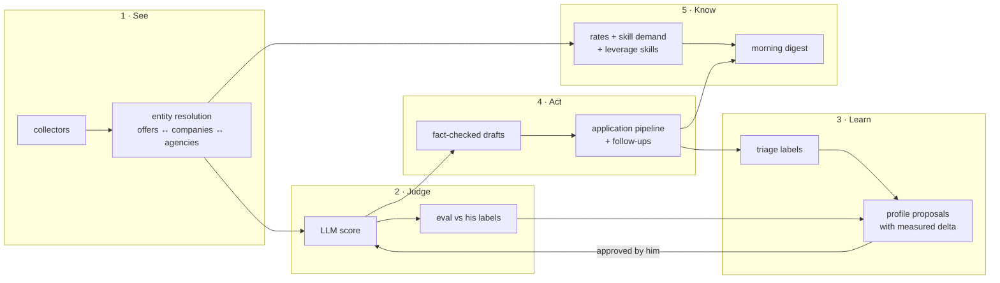

# Moonshot: from job feed to a self-calibrating career engine

Prompt: "What would be an absolute moonshot to improve job-agent? Unlimited dev resources, 12 months."
Branch: `moonshot` (integration branch; never merged into `main` without the user's approval).

## Where we are (2026-10-27)
- 403 offers from 5 sources after one day; 1 260 scores across 5 profile versions; model average 3.1/10.
- **4 offers carry a user verdict.** Every scoring change so far was judged by eye. The system cannot tell
  whether a new profile or model is better, cannot learn from the user, and cannot say what to do next.
- The output ends at "here is a list". Everything after it (deciding, replying, following up, learning what
  the market pays and wants) happens in Filip's head.

## The moonshot
**job-agent becomes a closed-loop career engine for one person: it measures its own judgment against his,
improves itself only with his approval, tells him what the market pays and wants, and turns every good offer
into a ready, fact-checked next step that he sends himself.**

Five loops, each measurable:

### North-star metrics
| Metric | Today | Moonshot target |
|---|---|---|
| Labeled offers | 4 | 300+ (30 s per label) |
| Score ↔ label agreement (ROC AUC) | unknown | measured on every profile/model change, ≥ 0.85 |
| Precision of the top 10 each morning | unknown | ≥ 7 of 10 he would act on |
| Minutes per day to process the feed | ~30 | ≤ 5 |
| Offer → sent reply time for a good offer | manual | ≤ 3 min with a fact-checked draft |
| Knows his market rate band (IČO vs HPP, CZK/h) | no | yes, per form and place, updated daily |

### Hard lines (unchanged, they are what makes this safe)
- Never auto-apply, never submit forms, never send a message on his behalf. Drafts are copied by hand.
- Drafts may only claim what `data/facts.md` (his file) states; every claim cites a fact or is dropped.
- Profile changes are proposals; only his click applies them.
- One polite run per source per day, robots.txt respected. No new scraping surface without a robots check.
- Single user, LAN/Tailscale only, no auth surface added.
- App LLM calls stay on OpenCode Go with `muse-spark-1.3-contributor` or `deepseek-v4.1-flash`.

## 12-month plan

### Q1 — Ground truth (months 1–3)
- **Triage mode**: one card at a time, one key per verdict, reason chips. Queue ordered by information value
  (scores near the decision boundary, sources and tabs mixed) so each label teaches the most.
- **Eval harness** (the "typed judge" from VISION Later): metrics of the stored scores against his labels
  (verdict agreement, score separation, ROC AUC, precision@k, worst disagreements) and **replay**: re-score
  only the labeled set under another profile or model without touching production scores. Every profile or
  model change gets a number before it ships.
- Later in the quarter: pairwise "which of these two" labels for fine ordering; inter-day consistency check
  (re-show an old card, measure his own noise floor).

### Q2 — Learning loop (months 3–5)
- **Profile proposals**: an LLM reads the disagreements and his reasons, proposes a revised profile; the eval
  replays old vs. new on the labeled set; the Profil tab shows the diff and the measured delta;
  Apply / Reject. Nothing changes without his click.
- Weekly cadence once enough labels exist; proposals that do not beat the current profile are not shown.
- Model routing by evidence: muse vs. deepseek flash decided by replay agreement and cost, per tab.

### Q3 — Market intelligence + morning digest (months 5–7)
- **Rate statistics**: every salary/budget normalised to CZK/h (monthly ÷ 160, yearly ÷ 1 920, EUR → CZK),
  percentiles per form (HPP vs IČO/contract) and place (Olomouc, remote CZ, remote EU, Praha).
  Answers "is my current rate low?" with the market's own numbers.
- **Skill demand**: deterministic skill dictionary over descriptions; demand overall and in high-fit offers;
  **leverage skills** = skills most often named in his gaps among offers capped below fit.
  Answers "what one skill opens the most good offers?".
- **Morning digest**: new actionable offers, newly opened agency positions, due follow-ups; written to
  `data/digest/`, optional push to a notification topic he owns (to himself only, opt-in).

### Q4 — Application copilot (months 7–9)
- `data/facts.md`: his verified facts, numbered. Draft replies built only from facts; every claim sentence cites
  fact ids and is validated deterministically; uncited claims are dropped and shown as removed.
- **Pipeline**: per-offer stage (drafting → applied → interview → offer / rejected / withdrawn), next-action
  date, notes; follow-ups surface in the digest. Agencies keep their own pipeline.
- Later: interview prep sheets from the offer + facts; outcome data feeds back into scoring (offers that
  led to interviews are the strongest labels).

### Q5 — Seeing the whole market (months 9–11)
- **Entity resolution**: the same job on several boards becomes one item with "also on …"; offers posted by a
  tracked agency link to it (VISION: "Offers posted by an agency link to it"); company keys across sources.
- Coverage: per-company Ashby/Workable/Greenhouse boards discovered from companies he rated well
  (robots-checked, tracked-company only); jobs.cz brand-widget full text if an allowed source exists.

### Q6 — Experience (months 11–12)
- Installable PWA, mobile-first triage, keyboard everywhere, motion polish (Framer Motion, VISION Later).
- Offline read of the morning list.

## Implementation phases on this branch
Each phase is one slice run by workers per `docs/PARALLEL.md` and `docs/LEAD.md`, merged into `moonshot`
one branch at a time with `bun test && bun run typecheck && bun run web:build` after every merge.

| # | Phase | Workers (branch from `moonshot`) | Status |
|---|---|---|---|
| 1 | Ground truth: eval harness + triage mode | `ms1-eval`, `ms1-triage` | ✅ merged: `bun run eval [--replay]`, Triáž tab |
| 2 | Learning loop: profile proposals with measured delta | `ms2-tune-api`, `ms2-tune-ui`, fix `ms2-holdout` | ✅ merged: `bun run tune`, weekly in `daily`, Profil-tab proposal panel |
| 3 | Market intelligence + morning digest | `ms3-market-api`, `ms3-market-ui`, `ms3-digest` | planned |
| 4 | Application copilot: facts, fact-checked drafts, pipeline | `ms4-copilot-api`, `ms4-copilot-ui` | planned |
| 5 | Active learning: second-opinion model (deepseek flash) drives Triáž order and model routing evidence | `ms5-second-opinion` | planned |
| 6 | Experience: PWA, keyboard, motion polish | `ms6-experience` | planned |

Phase 5 re-plan: entity resolution was measured on the 2026-10-27 snapshot before building it. Only 3 companies
appear on more than one source (all with different roles) and 0 offers match a tracked agency, so it stays in Q5
of the 12-month plan and is not built now. Q2 "model routing by evidence" moves forward instead.

Out of scope even here: sending anything, new scraping sources without robots review, multi-user, auth.
