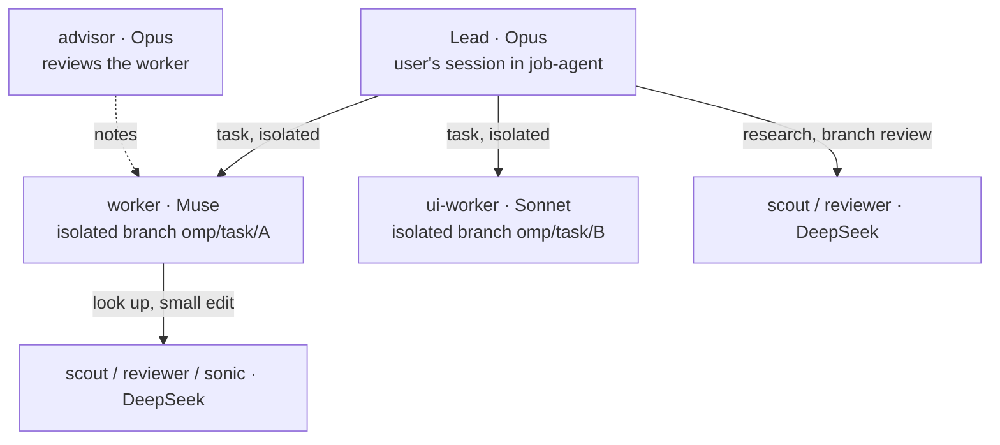

# Parallel work

How to think about parallel agent work on this repo: three roles (lead, worker, helper), two run modes (native subagents by default, Ghostty panes as fallback).
The spawn mechanics — commands, prompt templates, checklists — live in `docs/LEAD.md`.

## Roles

| Role | Job | Model | May |
|---|---|---|---|
| Lead (exactly one) | decides: plan, contracts-first ordering, task prompts, review, merge | `default` → Claude Opus 5.5 | start workers and helpers; the only one who merges into `main`; does **not** write feature code (contracts included) — its own commits are merge fixes, docs and lead tooling |
| Worker (`worker`) | builds one task on its own branch: backend, data, collectors | `worker` → Muse Spark 1.3 Contributor | edit the files its task lists, commit on its branch, start helpers |
| UI worker (`ui-worker`) | same, for `web/**` | `ui` → Claude Sonnet 5.5 | edit the files its task lists, commit on its branch, start helpers |
| Helper (`scout`, `reviewer`, `sonic`, `task`) | looks things up and checks: research, branch review, small mechanical edits | `task` → DeepSeek V4.1 Flash | `scout` and `reviewer` read only; `sonic` makes small edits |

- **User**: approves plans, merges and pushes; watches workers (Agent Hub `Alt+A`, or Ghostty panes); answers workers that ask.
- **Advisor** (not in the chain): a reviewer attached to every native worker, `advisor` → Claude Opus 5.5 at medium effort, reviews every 4th worker turn against `.omp/WATCHDOG.md`, never edits. Config: `.omp/WATCHDOG.yml`; rules: `.omp/WATCHDOG.md`.

### Role is not spawn depth

Everything the lead starts natively is technically a subagent, so spawn depth says nothing about the role.
The role comes from the agent type (`worker`, `ui-worker`, `scout`, `reviewer`, `sonic`, `task`), and the agent type fixes the model (`.omp/config.yml`, `.omp/agents/`).
The chain is at most lead → worker → helper (`task.maxRecursionDepth: 2`), so a worker can start helpers but a helper cannot start a worker.
A `scout` or `reviewer` the lead starts directly is still a helper on the helper model — not a second lead.

## Two run modes

| | Native (default) | Ghostty |
|---|---|---|
| Worker is | a `task` subagent of type `worker`/`ui-worker` with `isolated: true`, in an APFS clone of the repo | a separate `omp` session in a pane of the "workers" window (`scripts/spawn-worker.sh`) |
| Visible in | Agent Hub (`Alt+A`), live preview under the editor | the pane |
| Result | branch `omp/task/<name>` + final answer | its branch + report in `.lead/reports/<task>.md` |
| Survives the lead session ending | no (`omp --restore` resumes it) | yes |
| Worker's helpers | its subagents | its subagents |

Use Ghostty only for runs that must outlive the lead session, or when the user wants a pane.
The mental model is the same in both modes: the lead splits the work, workers build on their own branches, helpers look things up for workers and the lead, the lead reviews and merges.

## Where work happens

### Native

- omp clones the repo per worker, the worker commits there, omp captures the commits on `omp/task/<name>` and applies nothing (`task.isolation.merge: branch`, `apply: false`).
- The lead's working tree must be clean before spawning: uncommitted files leak into the worker's baseline and break capture.
- A finished isolated worker cannot be messaged; a fix round is a new worker whose task starts with `git cherry-pick <base>..omp/task/<name>`.

### Ghostty

Worktrees are for real concurrency only; a single worker does not need one.

| Situation | Where the worker works |
|---|---|
| One worker, lead not editing tracked files meanwhile (prompts and reports in gitignored `.lead/` are fine) | Main checkout, branch `<slice>-<task>` from `main` |
| Fix round for a branch that is not merged yet | Same place, same branch |
| 2–4 workers at the same time, disjoint file sets | One worktree per worker in `.worktrees/<task>`, removed after merge |
| More than 4 at once | Don't: review cannot keep up |

Commands (lead):
- Single worker: `git switch -c <slice>-<task> main` in the main checkout; after merge `git switch main`.
- Concurrent worker: `git worktree add .worktrees/<task> -b <slice>-<task> main`, then `bun install` in it and copy `.env` if needed. `.worktrees/` is gitignored, so `bun test`, `tsc` and `git status` in the main checkout ignore it.
- Reviewers only read (`git diff main...<branch>`, `git log`); no checkout, commit or edits.

The 4-workers cap applies to native workers too: review cannot keep up with more.

## Before dispatching

1. Everything workers must read (AGENTS.md, docs/*) is committed on `main`; clones and worktrees only see committed files.
2. Each task lists its file set ("Files you may change: …"). Concurrent tasks have disjoint sets; tasks touching the same file run one after another. Name shared registries (e.g. `COLLECTORS` in `src/cli/collect.ts`) up front.
3. Shared contracts (schema, types, API shape) are a short worker task merged first; parallel workers start from that `main`.
4. Untracked state is per clone/worktree: `node_modules`, `.env`, databases. Never share `data/jobs.db`; use `DB_PATH=data/dev.db` or a `/tmp` DB.
5. HTTP responses are shared read-only through the main checkout's cache: `HTTP_MODE=replay HTTP_CACHE_DIR=/Users/filip/projects/job-agent/data/http-cache`.
6. Ghostty only: the prompt starts with the place (main checkout or worktree path), the branch and the file set (template in `docs/LEAD.md`).

## While working

- Workers commit locally on their branch, never push, never merge, never rebase other branches.
- No `git stash`: `refs/stash` is shared by every worktree and clone of this repo.
- Live network runs (`bun run collect`) only when the task asks for it; jobs.cz allows one polite run per day, not one per worker.
- A worker that needs a file outside its file set stops and reports instead of editing it.
- Workers never wait for, poll or read other workers. A missing piece owned by another worker is built against the task's contract (local stub or type) and reported.

## Integration (lead only)

1. Review each branch: native — `git diff <base>..omp/task/<name>` and the transcript `history://<name>`; Ghostty — `bun scripts/audit-worker.ts <task>`. Then the lead re-runs the checks and starts a `reviewer` helper (`docs/LEAD.md`).
2. Merge into `main` one branch at a time, fast-forward or `--no-ff`; after each merge run `bun test && bun run typecheck && bun run web:build` on the merged result, and `docker compose build` when `package.json`, `bun.lock` or the Dockerfile changed (each branch passing alone does not prove the merge works).
3. Clean up: delete the merged branch (`git branch -d omp/task/<name>` or `git branch -d <slice>-<task>`) and its worktree if it had one (`git worktree remove .worktrees/<task>`).
4. Push `main` only after the user approves.

## When to parallelise

- Good: independent collectors (one directory each), UI vs. collector work, docs vs. code. Exception to disjoint files: each collector adds one `COLLECTORS` entry in `src/cli/collect.ts`; the lead resolves those conflicts at merge (`docs/COLLECTORS.md`).
- Bad: review fixes, schema changes, anything touching `src/db.ts`, `src/types.ts` or `src/pipeline.ts`; do these in one worker.
- Split big work into several workers, not inside one worker; a native worker's helpers are for look-ups and small mechanical edits.

## omp keywords

- `orchestrate`: a standalone lowercase word in a prompt a human types (punctuation such as `orchestrate:` may touch it) adds omp's orchestration contract — scope the whole request, delegate independent work in parallel, verify each phase, continue until done. Use it in the lead's own prompts. It never triggers in agent-initiated prompts, so it does nothing in a native worker's task text; in a Ghostty prompt file it reaches the worker (rules for that in `docs/LEAD.md`).
- `workflowz`: adds omp's scripted fan-out contract (`eval` `agent()`, `workpool()`, `wait()`) — the plan lives in a script, not in the lead's context. For broad, repeatable jobs: re-verifying agencies, checking score calibration on a sample of offers, finding more agencies until the list stops growing.

Source: `omp://magic-keywords.md`.
